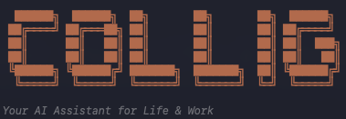

# Collig: Your Intelligent AI Co-worker

Collig is a powerful, locally-running AI agent designed to act as your personal pair programmer and digital assistant. It combines a robust Python backend with a modular skill system, allowing it to interact with your filesystem, browser, email, and more.

## 🚀 Features

-   **🧠 Intelligent Agent:** Powered by LLMs (OpenAI GPT-4o) to understand natural language intent.
-   **🧑‍🤝‍🧑 Knows You Over Time (long-term memory):** Durable facts, preferences and
    routines are captured automatically and injected into the system prompt on
    later sessions — home city from repeated weather checks, family details,
    projects, "I always check AI news in the morning", and so on. Stored as
    readable JSON + Markdown under `~/.collig/memory/`, with per-fact confidence,
    provenance and a full audit log.
-   **🎭 Distilled Personalities:** `/distill <person>` collects public reference
    material and builds a personality folder; `/chatto <person>` makes Collig
    think, reason and talk in that style until `/chatto off`. A digital copy of
    the person's way of thinking, stored as editable Markdown.
-   **⚡ Token-Efficient Tool Usage:**
    - Intelligent tool filtering based on user intent — trivial queries (math, greetings) bypass tools entirely.
    - Intent-matched queries use only relevant tools instead of all 54 tools, reducing token usage by up to 97%.
-   **🔌 Modular Skill System:**
    - **Built-in Skills:** Filesystem management, Web browsing, Email (Gmail), Weather with multi-day forecasts, Flight search with live fares, Git operations, Bookmarks, Notes, Lunar Calendar, News search, and more.
    - **Extensible:** Supports **Markdown-based Skills** (`SKILL.md`) compatible with the [Open Agent Skills](https://github.com/vercel-labs/skills) standard.
-   **🌦️ Weather Forecasts:** Multi-day weather support — ask about tomorrow, next week, or specific days.
-   **💾 Long-term Memory:** Durable facts live in a local, readable store; notes are kept in plain-text JSON (`~/.collig/data/memory_notes/notes.json`) and diary entries in `~/.collig/data/diary/diary.json`, so both save without an embedding provider or API credits. ChromaDB remains in use for semantic search over bookmarks, and old diary collections are imported once.
-   **🌐 Web Admin Console:** A full Vue 3 + Vuetify web application with:
    - 💬 **Chat** — Full conversation UI with markdown rendering and token stats
    - 📊 **Dashboard** — Real-time statistics for bookmarks, notes, and chat sessions
    - 🗂️ **Sessions** — Browse, view, and delete all past chat session UUIDs with conversation previews
    - 🔖 **Bookmarks** — Full CRUD table with search, tags, and resizable column widths
    - 📝 **Notes** — Card-based layout with search, edit, and delete
    - 🎨 **Light/Dark Theme** — Toggle with persisted preference
-   **💻 Interactive CLI:** A rich terminal interface with autocompletion, session management, history, a structured thinking/planning timeline, `!<command>` shell passthrough, `/<tool>` direct tool calls, and `/console` commands for admin console management.
-   **🖥️ Browser Terminal:** Run the actual CLI in a browser via xterm.js and a real PTY. Every session is its own ephemeral Docker sandbox with only its own home/workspace, a read-only root, no capabilities and no reachable host filesystem, so `!ls /home` cannot see another user's files. See [Web Terminal](#-web-terminal). Type `/` to open the command menu: `↑/↓` to navigate, `Tab` or `Space` to complete, and `Enter` to run (use `Space` first when the command takes a parameter). Commands that take a personality name or memory key — `/chatto`, `/personality`, `/distill show|rm`, `/memory forget` — list the available values as soon as you press `Space`, so you can pick one with `↑/↓` and finish with `Tab` or `Space`.
-   **🛡️ Secure & Local:** Runs on your machine. Includes `backup`, `restore`, and `load` commands for easy data migration.
-   **🔄 Auto-Reload:** The admin console server automatically restarts when Python files change.

## 🛠️ Tech Stack

-   **Backend:** Python 3.13+, FastAPI, Google ADK (agent harness), LiteLLM, ChromaDB
-   **Frontend:** Vue 3, Vite, Vuetify 3, Vue Router, Marked
-   **Package Management:** `uv` (Python), npm (Frontend)

## 📦 Installation

Prerequisites:
-   Python 3.13+
-   `uv` (Python package manager)
-   Node.js / npm (for frontend)
-   An API key for your chosen provider (OpenAI, DeepSeek, DashScope) or a local Ollama server

1.  **Clone the repository:**
    ```bash
    git clone https://github.com/yourusername/collig.git
    cd collig
    ```

2.  **Install dependencies:**
    ```bash
    make install
    ```

## 🏃 Usage

### CLI Assistant (Recommended)
Start the interactive AI co-worker in your terminal:
```bash
make pa
```
*On first run, it will ask for your OpenAI API Key.*

**Commands:**
-   `/exit` or `exit`: Quit the session.
-   `/clear` or `clear`: Clear the screen.
-   `/backup`: Backup your data (config, memory, sessions, bookmarks, notes, diary) to a zip file.
-   `/restore <path>`: Restore data from a backup zip (overwrites existing data).
-   `/load <path>`: Load and merge data from a backup zip (preserves existing entries, only adds new ones).
-   `/config`: Provider-scoped configuration manager. Pick a provider, then
    edit only that provider's key, endpoint and model. `Esc` goes back one
    level; `q` quits.
-   `!<command>`: Run a shell command directly, e.g. `!pwd`, `!git status`.
-   `/<tool> [args]`: Call a tool directly without a model round-trip, e.g.
    `/get_current_time`. This is the cheapest path for deterministic tools.
-   `/stats`: View token usage statistics.
-   `/status`: Check system status and LLM connection.
-   `/distill <person>`: Build a reusable personality from public resources
    (e.g. `/distill Spider-Man`). If several people share the name, pick one
    from the menu (or `/distill 宋佳 2` / `--pick 2`). `--for <reason>` records
    why you want the person (otherwise inferred). Use `--force` to rebuild,
    `list` to list, `show <name>` to print it, and `rm <name>` to delete it.
-   `/chatto <person>`: Activate a distilled personality (e.g.
    `/chatto Spider-Man`); `/chatto off` returns to plain Collig, `/chatto`
    shows the active one. The choice survives restarts.
-   `/personality`: Alias for showing/switching the active personality.
-   `/load-personas`: Browse the shared persona market, install one by number or
    name, search it, refresh it, or install everything with `--all`.
-   `/memory`: Show what Collig remembers about you. Subcommands:
    `list`, `search <query>`, `forget <key>`, `note <text>`, `clear`,
    `on`/`off`, `proactive on|off`, `extract on|off`, `path`.
-   `/news`: Browse the current news list, or reopen the most recent cached
    search if this process has no current list. After a news answer the CLI
    prints a hint like `📰 8 news items ready · /news last to browse` and
    keeps the prompt; the browser only opens when you ask for it (it is
    keyboard-modal, so Esc quits back to the chat prompt).
-   `/news last`: Reopen the most recent cached search without searching again.
-   `/news load <n>`: Load a saved search by number or cache id.
-   `/news save`: Save the current list explicitly (searches are also cached
    automatically).
-   `/news cached`: Browse all saved searches.
-   `/read_news_item 1`: Read item 1 from the current list. After a restart,
    the most recent cached search for the session is loaded automatically.
-   `/console status`: Check if the admin console is running.
-   `/console start`: Start the admin console on port 5005.
-   `/console stop`: Stop the admin console.

### Web Admin Console
Start the web application:
```bash
make console-start
```
Then open **http://localhost:5005** in your browser. The console includes:
- Chat interface for conversing with Collig
- Dashboard with real-time statistics
- Session browser to view and manage past conversations
- Bookmark and note management with full CRUD

Stop the console:
```bash
make console-stop
```

### 🖥️ Web Terminal

The admin console has a **Terminal** page that runs the real `core/cli.py` in a
browser. It is a real PTY, not a chat box that pretends to be a shell: colours,
prompt_toolkit menus, `/` completion, `/<tool>` calls and `!<command>` all work.

```bash
make terminal-image     # one-time build of the sandbox image (Docker required)
make console-start      # open http://localhost:5005/ and choose "Terminal"
```

The first start can take a few minutes because the image installs Collig's Python
dependencies. Later starts use the cached image. Every browser connection gets a
fresh session and is deleted when it closes.

The terminal title bar has a sun/moon control for the terminal's own dark/light
theme (dark by default, remembered in `localStorage`). When the terminal was
opened from a session row, it also shows which web-chat session is being resumed.

#### Why a shell in the browser is safe here

The CLI has a deliberate `!<command>` escape hatch. A command deny-list is not a
security boundary — `!/bin/ls /home`, `!python -c ...` and `!cat` all walk around
it. The only defensible boundary is the operating system, so the terminal is
executed inside a short-lived Docker container:

| Control | Effect |
| --- | --- |
| Per-session `$HOME` + `/workspace` bind mounts | `!ls /home` sees the container's own user, never the host's users or project files. |
| Read-only container root, `--cap-drop ALL`, `no-new-privileges`, `--init` | No writes outside the two mounts, no privilege escalation, no daemons. |
| `--pids-limit`, `--memory`, `--cpus`, `nofile` | One session cannot exhaust the host. |
| Private, `--internal` Docker network | No route to the host, LAN, cloud metadata or the Internet. |
| Per-session relay sidecar | Forwards only four LLM paths (`chat/completions`, `completions`, `embeddings`, `models`) to the app. It cannot be used to call `/api/config` or another host port. |
| Host-side LLM proxy | The real provider key and the per-session proxy token stay outside the sandbox. The CLI config contains only the relay URL and a non-secret placeholder key; the proxy forces the configured model. `!env` / `!cat ~/.collig/config.json` reveal nothing reusable. |
| Shared access token + one-shot WebSocket tickets + Origin checks | Only authorised browsers can create a session; a foreign page cannot open a WebSocket to a local terminal. |
| Idle/absolute timeouts, max sessions, cleanup | Abandoned containers and API quotas do not accumulate. |

The **only** data the sandbox keeps is its own temporary home and workspace
(under `~/.collig/terminal/sessions/`), and both are removed on disconnect unless
`COLLIG_TERMINAL_KEEP_SESSIONS=1` is set. The CLI can still talk to the configured
model through the proxy, but network-dependent skills (weather, news, flights)
cannot reach the Internet in the default `internal` network mode.

#### Access control

*   **Localhost:** the page automatically fetches the terminal token from the
    server when the TCP peer is loopback and no forwarding headers are present.
    That is convenient for development and no worse than local shell access.
*   **Shared/remote:** set a token and give it to your users:

    ```bash
    export COLLIG_TERMINAL_TOKEN="$(python -c 'import secrets; print(secrets.token_urlsafe(32))')"
    make console-start
    ```

    The page asks for the token on first use and keeps it in `sessionStorage`.
    Reverse-proxy deployments **must** set this token: behind a proxy every request
    looks like loopback, so auto-bootstrap is disabled whenever
    `X-Forwarded-For` / `Forwarded` is present. Serve the app over HTTPS when it is
    shared: the token is a bearer credential.

> **Do not expose the rest of the admin console publicly without real auth.**
> The terminal feature hardens itself, but the existing `/api/config`, `/api/chat`
> and skill endpoints have no user accounts. Put the whole app behind your SSO /
> reverse-proxy auth if it is not just on your machine.

#### Terminal configuration

| Variable | Default | Meaning |
| --- | --- | --- |
| `COLLIG_TERMINAL_ENABLED` | `1` | Turn the feature off with `0`. |
| `COLLIG_TERMINAL_TOKEN` | generated | Shared access token; generated at `~/.collig/terminal.token` (0600) if unset. |
| `COLLIG_TERMINAL_ALLOW_LOCAL` | `1` | Allow loopback auto-bootstrap of the token. |
| `COLLIG_TERMINAL_IMAGE` | `collig-terminal:latest` | Sandbox image used by `make terminal-image`. |
| `COLLIG_TERMINAL_NETWORK` | `internal` | `internal` (no egress), `bridge` (Internet **and host reachable**; trusted local use only) or `none` (no model proxy). |
| `COLLIG_TERMINAL_MAX_SESSIONS` | `8` | Concurrent terminal sessions. |
| `COLLIG_TERMINAL_IDLE_TIMEOUT` | `900` | Seconds before an idle session is reaped. |
| `COLLIG_TERMINAL_MAX_DURATION` | `3600` | Hard lifetime of one terminal session. |
| `COLLIG_TERMINAL_KEEP_SESSIONS` | `0` | Keep session home/workspace on disk after disconnect. |
| `COLLIG_TERMINAL_PROXY_PORT` | request port | Host port the per-session relay uses for the LLM proxy. |
| `COLLIG_TERMINAL_ALLOWED_ORIGINS` | empty | Extra comma-separated browser origins allowed to open the WebSocket (`make up` sets the Vite dev origins). |

`COLLIG_TERMINAL_BACKEND=host-unsafe` exists only for debugging the PTY path
and additionally requires `COLLIG_TERMINAL_ALLOW_UNSANDBOXED=1`. It runs the CLI
on the host and does **not** provide the container boundary; never use it for a
shared deployment or for untrusted users.

### 🚀 Terminal-First Console (Port 5006)

Port **5005** keeps **Chat** as its landing page. Port **5006** serves the same
full console but lands on **Terminal** — with the sidebar available for Chat,
Sessions, Dashboard, Bookmarks, Notes, Diary and Settings.

```bash
make terminal-app
# -> http://localhost:5006/  (or first free port above 5006)
```

Both ports use the same frontend build and the same APIs; only the landing route
is injected by the server through `COLLIG_LANDING_VIEW`.

The sidebar is collapsible via the menu button in the app bar. On the Sessions
page every session has two actions:

- **Web** — continue the conversation in the chat UI.
- **Terminal** — resume that exact session in the sandboxed CLI.

Resuming copies only the selected session JSON into the terminal's fresh HOME,
starts the CLI with `--session <id>`, and syncs that one session back when the
terminal closes. Other host sessions are never mounted into the sandbox.

Useful targets and options:

```bash
make terminal-app          # build the full SPA and run the terminal-first app
make terminal-app-status   # show the port/PID
make terminal-app-stop     # stop the process from ~/.collig/terminal-app.port
TERMINAL_PORT=8080 make terminal-app
```

For a service manager or container deployment, run uvicorn directly:

```bash
export COLLIG_TERMINAL_TOKEN="$(python -c 'import secrets; print(secrets.token_urlsafe(32))')"
export COLLIG_TERMINAL_PROXY_PORT=5006
export COLLIG_LANDING_VIEW=terminal
uv run uvicorn core.main:app --host 0.0.0.0 --port 5006
```

For a shared/server deployment:

1. Set `COLLIG_TERMINAL_TOKEN` to a strong secret. Without it, only a loopback
   browser can bootstrap the generated token; remote users cannot obtain it.
2. Put the app behind HTTPS and your SSO/reverse-proxy auth; this is the full
   console, not a reduced API surface.
3. Make sure Docker is available and `collig-terminal:latest` has been built
   with `make terminal-image` after terminal code changes.
4. Serve it at the root of a hostname (for example `terminal.example.com`).
5. If a reverse proxy terminates TLS, set `COLLIG_TERMINAL_PROXY_PORT` to the
   internal uvicorn port (for example `5006`) and either preserve the public
   `Host` header or add the public origin to `COLLIG_TERMINAL_ALLOWED_ORIGINS`.

`core.terminal_app` remains available as an optional terminal-only FastAPI app
for deployments that intentionally want no chat/admin routes; `make terminal-app`
now runs the full terminal-first console instead.

### Managing Sessions
List previous chat sessions:
```bash
make list-sessions
```
Resume a session:
```bash
make pa session=<SESSION_ID>
```

In the web UI, each row on the Sessions page has two actions: **Web** opens
`/chat/<id>`, and **Terminal** opens `/terminal?session=<id>` so the same chat
session is seeded into a sandboxed CLI. Only that session is copied into the
terminal HOME and synced back when the terminal closes.

## 🧠 Memory & Personalities

### What Collig remembers about you

Collig builds a persistent profile so it can behave like a work buddy who
already knows you. You do not have to run any command for the basics:
durable details are captured from conversation, for example:

- `I live in Sydney` → home location (used when you later ask "what's the weather?")
- asking for the weather in the same city repeatedly → inferred home location,
  with moderate confidence rather than a hard assumption
- `my daughter will have a party` → a family detail with its source and date
- `I always check AI news in the morning` → a routine. On a later morning
  greeting Collig can proactively search the news instead of waiting to be asked
- "I mostly use Python" → a preference that shapes later answers

Facts are ranked: something you state explicitly outranks something inferred,
and your correction outranks both. Nothing sensitive (passwords, API keys,
card/bank numbers, SSNs) is stored.

Storage is deliberately **not** a vector database. The profile is small, so it
is kept as structured JSON plus a generated Markdown view and injected into the
system prompt. That makes it portable, inspectable, diffable and independent of
an embedding provider:

```
~/.collig/memory/
    profile.json    # facts, interests, routines and skill usage
    USER.md         # human-readable view (read-only; edit via commands)
    events.jsonl    # append-only audit log of every change
```

Control it with `/memory`:

```
/memory                  # see everything remembered
/memory search city      # look up a fact
/memory forget home_location
/memory clear            # wipe the profile
/memory off              # pause capture and injection (data is kept)
/memory proactive off    # stop acting on routines automatically
/memory extract off      # stop the background LLM from enriching memory
```

Automatic capture is rule-based first (works with no key and adds no latency),
then optionally refined by a background LLM call on a daemon thread. The turn
you are waiting for never blocks on memory extraction.

### Distilled personalities

A personality is a folder of collected reference material turned into a
structured dossier by the configured model:

```
/distill Spider-Man
# -> ~/.collig/personalities/spider-man/
#      PERSONALITY.md   essence, own words, voice samples, worldview, voice, rules
#      meta.json        name, essence, purpose, provider/model, sources, timestamps
#      sources.md       references found during distillation
```

Distillation is **essence-first**, not a biography. Before the dossier is
written, a separate pass captures the one thing that makes the person
recognisable, why someone would want to talk to them, their own exact lines
and three worked exchanges. That is what makes 李煜 answer out of his own 词
and 李白 reach for his own 诗, instead of producing a generic "poet" voice:

```
/distill 李煜 --for 想听他用自己的词回应，也想让他新填一阕
Essence: 一个把亡国之痛写进词里的君王：越是写春花秋月，越是句句是泪。
Why you'd talk to them: 想听他用词说话，想让他用自己的旧作回应自己的处境…
Kept 4 of their own works/lines for verbatim use.
```

`--for` is optional: without it the reason is inferred from who you chose to
distill (a poet is usually distilled to hear and make poems; a strategist to
get decisions). You can also edit the "Your stated reason" and "Their own
words" lines in `PERSONALITY.md` later; the next turn picks the edit up.

Then activate it:

```
/chatto Spider-Man       # from now on, think and speak as this person
/chatto                  # show the active personality and its essence
/chatto off              # back to plain Collig
/distill list            # all personalities
/distill show Spider-Man # print the dossier
/distill rm Spider-Man   # delete it
```

### Same name, different people

Some names belong to more than one public person. `/distill` checks for that
before it writes anything:

```
/distill 宋佳
宋佳 could refer to more than one person:
  1. 大宋佳 (宋佳) — 中国内地影视女演员、制片人，1962年生…
  2. 小宋佳 (宋佳) — 中国内地女演员，歌手，1980年生，代表作《闯关东》《人世间》…

Reply /distill 宋佳 1 (or --pick 2, etc.) to choose one.
```

In the terminal the choices open as an arrow-key menu instead. Only the chosen
person’s sources are used for synthesis; the dossier starts with an explicit
identity line, and the model is told to discard material about namesakes. The
folder is stored under a readable display name (`~/.collig/personalities/小宋佳/`),
with `canonical_name: 宋佳` and both names as aliases in `meta.json`.

`/chatto` is ambiguity-aware too:

```
/chatto 宋佳     # offers 小宋佳 / 大宋佳 when both exist
/chatto 小宋佳   # unambiguous
```

The `/chatto ` completion menu shows the display names and their shared
canonical name, so two people with the same name are distinguishable before
you select one.

The dossier is injected at the end of the system prompt and a compact style
card is placed at the *top*, so it shapes voice and reasoning while Collig
still uses real tools and real data. Switching with `/chatto` also tells the
model to ignore the voice of earlier assistant turns, so an ongoing
conversation adopts the new persona immediately instead of continuing the old
slang. The persona is explicitly told to stay truthful, never to claim it is
the real person, and to drop the impression when safety or serious matters
require it. You can edit `PERSONALITY.md` by hand; the next turn picks up the
change.

`/distill` needs a configured chat model (run `/config` first). Web search is
best-effort; with no network it falls back to the model's own knowledge.

The same data is exposed for the web admin console: `GET /api/memory`,
`GET /api/personalities`, and `POST /api/personalities/distill`,
`/activate`, `/deactivate`, `/delete`. An ambiguous distill returns
`needs_choice` with candidates; repeat the request with `"pick": 2` to choose.
The chat box accepts the same `/distill`, `/chatto`, `/personality`,
`/load-personas` and `/memory` commands as the CLI.

### Persona Market

Collig remains the place where personalities are **created and distilled**.
Finished dossiers can be shared through the separate market repository
[cloudrevel-lab/collig-personas](https://github.com/cloudrevel-lab/collig-personas).

Inside the CLI or web chat:

```text
/load-personas                  List the market with numbered entries
/load-personas 2                Install entry 2
/load-personas 鲁迅              Install by slug, display name or alias
/load-personas search poet       Search names, aliases and descriptions
/load-personas --all             Install everything not already present
/load-personas --force 鲁迅       Replace an installed version
/load-personas refresh           Refresh the cached catalogue
```

The catalogue is fetched from the `main` branch and cached under
`~/.collig/personas-market/`; if GitHub is unreachable Collig falls back to the
cache. Every downloaded file is checked against the SHA-256 in `index.json`,
size-capped, parsed, and scanned for obvious credentials before it is written
to `~/.collig/personalities/<slug>/`. Market content is data only — nothing
from the repository is executed. The catalogue is a numbered list so it behaves
like an Emacs-style package list: list first, then install by number or name.

#### Publishing a persona

From a Collig checkout:

```bash
make push-personas personality=~/.collig/personalities/鲁迅
```

The helper validates the local dossier, clones the market, copies the persona,
regenerates `index.json`, runs the validator and test suite, creates a branch,
pushes it, and opens a pull request with the GitHub CLI. You need
`gh auth login` with write access. A dry run is available through:

```bash
uv run python scripts/push_persona.py --personality ~/.collig/personalities/鲁迅 --dry-run
```

For mirrors or forks, set `COLLIG_PERSONAS_REPO` and `COLLIG_PERSONAS_REF`
before starting Collig.

The market repository's CI runs the same data-contract checks on every PR:
required files, slug safety, size caps, index freshness, checksum validation,
and secret scanning. Reviewers still need to check voice quality, factual
accuracy, and that a dossier does not contain prompt-injection instructions;
persona dossiers are untrusted content until reviewed.

## 📦 Data Migration Between Devices

To transfer your Collig data (sessions, bookmarks, notes, diary entries, your remembered profile and distilled personalities) between devices:

### On Source Device (Export)
1. Run `make pa` to start the CLI
2. Type `/backup` to create a backup zip file
3. The backup will be saved as `collig_backup_YYYYMMDD_HHMMSS.zip` in the current directory
4. Transfer this zip file to your target device (via USB, cloud storage, etc.)

### On Target Device (Import)
1. Copy the backup zip file to your target device
2. Run `make pa` to start the CLI
3. Use `/load <path_to_backup.zip>` to merge the data
   - This preserves existing entries and only adds new ones
   - Sessions, bookmarks, notes, and diary entries are intelligently merged
   - Duplicate entries (by ID) are skipped

**Note:** If you want to completely overwrite existing data instead of merging, use `/restore <path>` instead. `/restore` also brings back `~/.collig/memory/` and `~/.collig/personalities/`; `/load` merges the legacy data sets and leaves memory/personalities untouched.

## 🧩 Adding Skills

Collig supports the [Open Agent Skills](https://github.com/vercel-labs/skills) format. You can easily add new capabilities by creating a `SKILL.md` file.

1.  Create a directory in `skills/imported/<your-skill>/`.
2.  Add a `SKILL.md` file:
    ```markdown
    ---
    name: My Custom Skill
    description: A description of what this skill does.
    ---
    You are an expert at <topic>. When the user asks about...
    ```
3.  Restart the agent. Collig will automatically load the new skill.

## 🤝 Contributing

Contributions are welcome! Please feel free to submit a Pull Request.

## 📄 License

[MIT](LICENSE)
